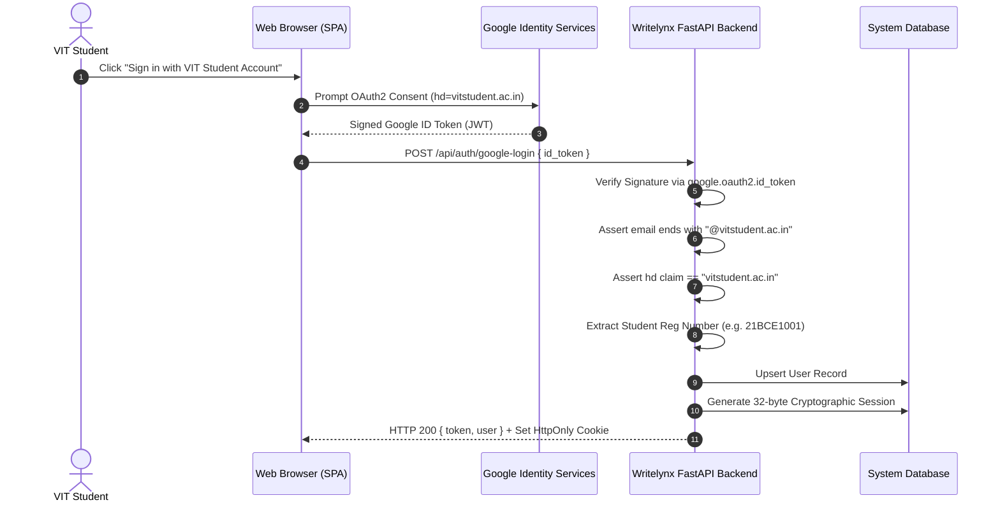

# Writelynx — Authentication Security & Student Identity Architecture

## 1. Authentication Overview

Writelynx enforces strict academic domain gating. Access is exclusively restricted to active students enrolled at the Vellore Institute of Technology holding official `@vitstudent.ac.in` Google Workspace accounts.

---

## 2. Token Lifecycle & Verification Protocol

---

## 3. VIT Domain & Identity Claims

1. **Email Domain Check**: The token `email` field is lowercased and verified with `email.endswith("@vitstudent.ac.in")`. Personal addresses (`@gmail.com`) and other universities (`@srmist.edu.in`, `@mit.edu`) are rejected with HTTP 403 Forbidden.
2. **Hosted Domain (`hd`) Assertion**: The Google ID token must contain `hd: "vitstudent.ac.in"`. This ensures that even if an email address appears valid, the token originated from the authorized Google Workspace tenant.
3. **Registration Number Parsing**: The prefix of the student email (e.g. `21bce1001@vitstudent.ac.in`) is parsed via regular expression `^([0-9]{2}[A-Za-z]{3}[0-9]{4})` to extract and normalize the student's official university registration number (`21BCE1001`).

---

## 4. Session Security

- **Session Tokens**: Generated using Python's `secrets.token_urlsafe(32)`, providing 256 bits of cryptographic entropy.
- **Expiration**: Stored with an explicit expiration timestamp of 7 days (`datetime.utcnow() + timedelta(days=7)`).
- **Transport Security**: Delivered as both an `Authorization: Bearer <token>` header and a secure `HttpOnly`, `SameSite=Lax` cookie.
- **Account Restrictions**: Every request validated via `get_current_user` queries the `user_restrictions` table to enforce immediate bans or suspensions without waiting for session expiry.
