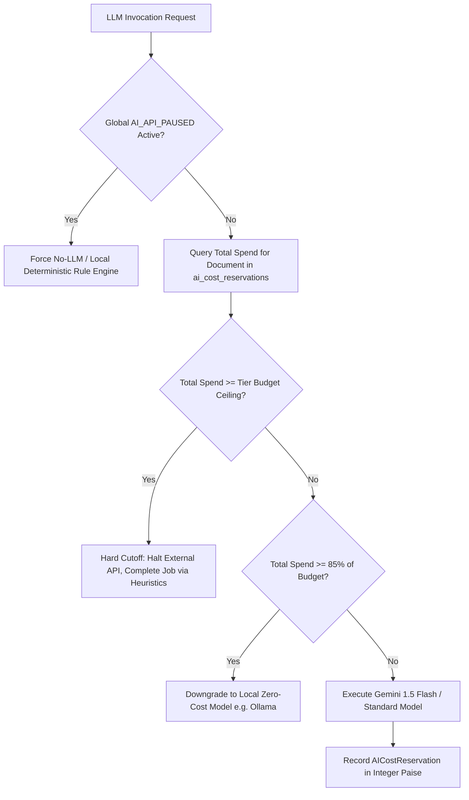

# Writelynx — AI Cost Governor & Budget Circuit Breaker

## 1. FinOps Objectives & Ceilings

To prevent runaway cloud API expenses from eroding margins or exposing the platform to denial-of-wallet attacks, Writelynx enforces strict, hard per-document AI spend ceilings in integer paise:

| Plan Tier | Student Price | Hard AI Budget Ceiling | Maximum Budget in Paise | Target Gross Margin |
| :--- | :--- | :--- | :--- | :--- |
| **Basic** | ₹20 | **₹4.00** | **400 paise** | **80.0%** |
| **Standard** | ₹50 | **₹9.00** | **900 paise** | **82.0%** |
| **Extended** | ₹100 | **₹24.00** | **2,400 paise** | **76.0%** |

---

## 2. Token Accounting & Real-Time Cost Tracking

Every API invocation dispatched through the writing assistant pipeline records prompt and completion tokens in the `ai_cost_reservations` ledger.

$$\text{Cost}_{\text{Paise}} = \left\lceil \left(\frac{\text{Tokens}_{\text{prompt}}}{1000} \times \text{Rate}_{\text{prompt}}\right) + \left(\frac{\text{Tokens}_{\text{comp}}}{1000} \times \text{Rate}_{\text{comp}}\right) \right\rceil$$

Estimated rates per 1,000 tokens (Gemini 1.5 Flash):
- Prompt tokens: ~1 paisa / 1k tokens
- Completion tokens: ~3 paise / 1k tokens
- Local Ollama & deterministic heuristics: 0 paise (Zero cost)

---

## 3. Circuit Breaker Mechanism

---

## 4. Emergency Kill Switches

Runtime platform controls can be instantly toggled by administrators via `POST /api/admin/kill-switch` without restarting backend processes:

1. `PURCHASES_PAUSED`: Stops the creation of new Razorpay orders (HTTP 503).
2. `UPLOADS_PAUSED`: Stops the issuance of new upload tokens (HTTP 503).
3. `PROCESSING_PAUSED`: Halts the execution of new document analysis jobs (HTTP 503).
4. `AI_API_PAUSED`: Immediately redirects all writing assistant queries to zero-cost local heuristics, bypassing external cloud billing entirely.
