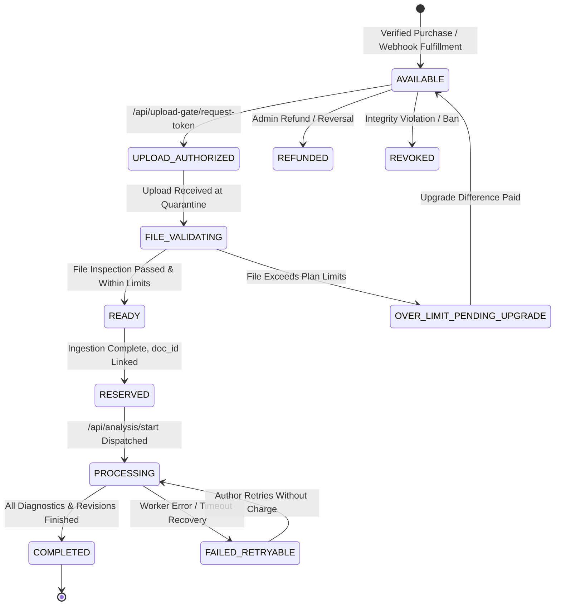

# Writelynx — Entitlement State Machine & Double-Spend Protection

## 1. Single-Use Entitlement Lifecycle

An **Entitlement** in Writelynx represents a paid authorization to process exactly one manuscript document under specific plan constraints (page count, character count, and file size).

---

## 2. Target Plan Configuration (Phase 1 Step 3)

| Plan Tier | Price (INR) | Price (Paise) | Max Pages | Max Characters | Max DOCX Size | Max AI Budget |
|---|---|---|---|---|---|---|
| **Basic** | ₹20.00 | 2,000p | 4 pages | 15,000 chars | 10 MB | ₹4.00 (400p) |
| **Standard** | ₹50.00 | 5,000p | 20 pages | 65,000 chars | 20 MB | ₹9.00 (900p) |
| **Extended** | ₹100.00 | 10,000p | 50 pages | 160,000 chars | 30 MB | ₹24.00 (2,400p) |

---

## 3. Double-Spending & Race Condition Mitigations

1. **State Transition Locks**: Every transition checks current state against `VALID_TRANSITIONS` in `EntitlementService`. Attempting to transition from `PROCESSING` or `COMPLETED` back to `AVAILABLE` triggers `HTTP 409 Conflict`.
2. **Failure Recovery (`FAILED_RETRYABLE`)**:
   - If a background job crashes, times out, or fails due to an upstream model error, the entitlement transitions to `FAILED_RETRYABLE`.
   - The student can retry processing the same document without being charged again.
   - The entitlement cannot be redirected to a new, unrelated document.
3. **Single-Use Upload Tokens**:
   - Calling `/api/upload-gate/request-token` transitions the entitlement from `AVAILABLE` to `UPLOAD_AUTHORIZED` and mints an ephemeral 15-minute token in `upload_reservations`.
   - Any prior unconsumed reservation for that entitlement is invalidated (`is_consumed = True`).
   - Upon upload receipt, the token is permanently consumed.
4. **One Document per Entitlement**: The `entitlements` table enforces a foreign key relationship to `documents.id`. Once linked, the entitlement cannot be bound to a second document.
5. **Database Transaction Boundaries**: SQLite WAL atomic compare-and-update patterns prevent race conditions when concurrent requests attempt to claim the same slot.
