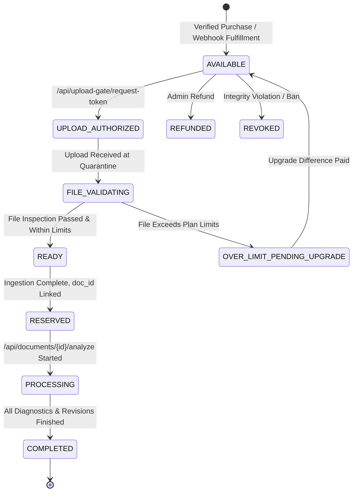

# Writelynx — Entitlement State Machine & Double-Spend Protection

## 1. Single-Use Entitlement Lifecycle

An **Entitlement** in Writelynx represents a paid authorization to process exactly one manuscript document under specific plan constraints (page count, character count, and file size).

---

## 2. Double-Spending Mitigation

1. **State Transition Locks**: Every transition checks current state against `VALID_TRANSITIONS`. Attempting to transition from `PROCESSING` or `COMPLETED` back to `AVAILABLE` triggers HTTP 409 Conflict.
2. **Single-Use Upload Tokens**:
   - Calling `/api/upload-gate/request-token` transitions the entitlement from `AVAILABLE` to `UPLOAD_AUTHORIZED` and mints an ephemeral 15-minute token in `upload_reservations`.
   - Any prior unconsumed reservation for that entitlement is invalidated.
   - Upon upload receipt, the token is permanently flagged `is_consumed = True`.
3. **One Document per Entitlement**: The `entitlements` table enforces a foreign key relationship to `documents.id`. Once linked, the entitlement cannot be bound to a second document.
