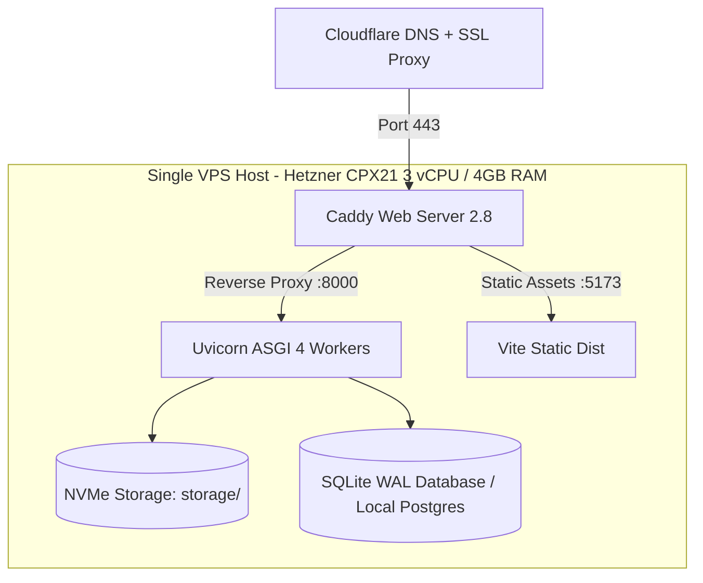

# Writelynx — Infrastructure & Hosting Architecture Decision

## 1. Hosting Context & Strategy

Writelynx serves student cohorts at VIT. The target audience profile is concentrated in bursts (e.g. assignment submission deadlines, midterm and final project reviews). A complex Kubernetes cluster or multi-cloud serverless mesh introduces excessive baseline operational overhead, cold starts, and unpredictable bills.

The optimal infrastructure architecture is a **single-node dedicated Virtual Private Server (VPS)** paired with a lightweight, high-performance reverse proxy.

---

## 2. Infrastructure Comparison & Sizing

| Provider / Tier | Specifications | Monthly Cost | Operational Suitability | Decision |
| :--- | :--- | :--- | :--- | :--- |
| **Hetzner Cloud CPX21** | 3 AMD vCPUs, 4GB RAM, 80GB NVMe, 20TB traffic | **€5.35 (~$5.80 / ₹480)** | Excellent CPU performance, high IOPS, lowest cost | **Recommended (Primary)** |
| **DigitalOcean Basic Droplet** | 2 vCPUs, 4GB RAM, 80GB SSD | **$24.00 (~₹2,000)** | Reliable, Bangalore data center availability | Alternative Option |
| **AWS ECS / Fargate + RDS** | Serverless containers + managed DB | **~$75.00+ (~₹6,200)** | Unpredictable egress, high baseline idle cost | **Rejected** |

---

## 3. Server Architecture Design

---

## 4. Key Operational Benefits

1. **Deterministic Monthly Infrastructure Spend**: Hosting costs remain fixed at ~₹480/month regardless of traffic spikes, eliminating cloud bill surprises.
2. **Low Latency Local File I/O**: Quarantining, inspecting, and repacking OpenXML DOCX files happens entirely in high-speed local NVMe storage without expensive S3 egress.
3. **Automated SSL/TLS**: Caddy automatically provisions and renews Let's Encrypt certificates without manual certbot cron jobs.
4. **Crash Recovery**: Systemd or Docker Compose handles automatic container restarts and healthcheck probes.
