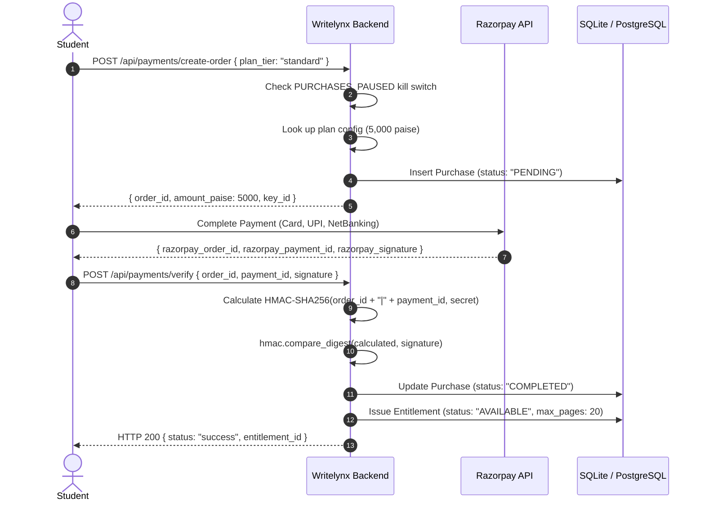

# Writelynx — Payment Security & Razorpay Integration Specification

## 1. Monetary Invariant: Integer Paise

In Writelynx, all financial values, prices, fees, differences, and budgets are strictly represented and calculated in **integer paise** (where 1 INR = 100 paise). Floating-point arithmetic is prohibited across all billing services to eliminate precision rounding errors and currency truncation discrepancies.

| Plan Tier | Price in Rupees | Authoritative Value in Paise |
| :--- | :--- | :--- |
| **Basic** | ₹20 | **2,000 paise** |
| **Standard** | ₹50 | **5,000 paise** |
| **Extended** | ₹100 | **10,000 paise** |

---

## 2. Order Creation & Verification Workflow

---

## 3. Cryptographic Signature Verification

Razorpay authenticates successful transactions using an HMAC-SHA256 signature generated over the concatenation of `order_id` and `payment_id` delimited by a pipe (`|`):

$$\text{Signature} = \text{HMAC-SHA256}\Big(\text{RAZORPAY\_KEY\_SECRET},\; \text{order\_id} \parallel \text{"|"} \parallel \text{payment\_id}\Big)$$

The backend uses `hmac.compare_digest` to perform constant-time comparison, guarding against timing analysis attacks.

---

## 4. Upgrades Without Double Charging

When a student purchases a Basic plan (₹20 / 2,000 paise) but uploads a 15-page document requiring the Standard plan (₹50 / 5,000 paise), Writelynx does not require paying full price again. 

The upgrade engine computes the exact mathematical difference:

$$\Delta_{\text{Upgrade}} = \text{Target\_Price}_{\text{Standard}} - \text{Current\_Price}_{\text{Basic}} = 5,000 - 2,000 = 3,000\text{ paise (₹30)}$$

Upon verifying the upgrade transaction, the existing entitlement is updated in-place to `max_pages: 20`, preserving the student's initial ₹20 investment.

---

## 5. Idempotent Webhook Processing

Razorpay delivers asynchronous webhooks for `payment.captured` and `order.paid`. To prevent race conditions and duplicate credit issuance:
1. Every incoming webhook signature is verified against `RAZORPAY_WEBHOOK_SECRET`.
2. The `event_id` is queried in the `payment_webhook_events` table.
3. If `event_id` exists, the backend immediately responds with `HTTP 200 { status: "already_processed" }`.
4. If new, the event is atomically stored, processed, and marked `processed = True` in a single database transaction.
