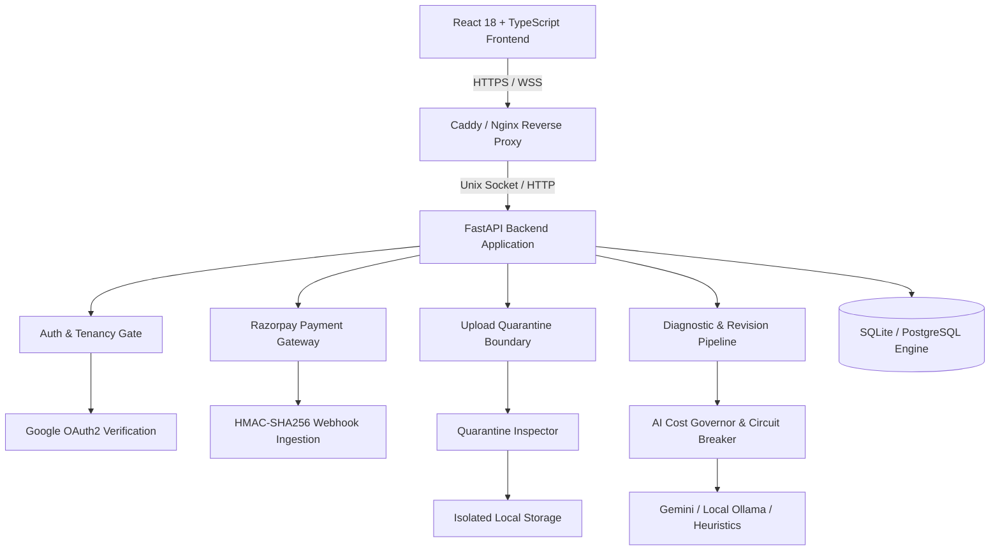

# Writelynx — System Architecture & Component Design

## 1. System Overview

**Writelynx** is an academic document analysis and integrity verification Software-as-a-Service (SaaS) built exclusively for students at the Vellore Institute of Technology (VIT). The system operates on a pay-per-document model with single-use entitlements, verified `@vitstudent.ac.in` Google Workspace OAuth authentication, pre-upload file validation, a quarantine inspection pipeline, and strict AI budget controls.

---

## 2. Core Architectural Principles

1. **Deny-by-Default Multi-Tenancy**: Every manuscript, uploaded source, analysis finding, and exported document is strictly scoped to the student who purchased the processing slot.
2. **Pay-Before-Upload Invariant**: Users cannot upload documents without an active, purchased `AVAILABLE` entitlement. Upload authorizations are single-use and expire within 15 minutes.
3. **Quarantine Before Ingestion**: Uploaded files land in an unprivileged quarantine directory (`storage/quarantine/`). Files are never executed and undergo deep OpenXML safety inspection (zip bomb, macro, XXE, path traversal) before promotion to `storage/documents/`.
4. **Authoritative Metric Enforcement**: Server-side page and character counting is authoritative. If a document exceeds the purchased plan limits, the transaction is marked `OVER_LIMIT_PENDING_UPGRADE` without destroying user quota or charging full price again.
5. **Hard Budget AI Ceilings**: Artificial intelligence calls are gated by strict document ceilings (Basic ₹4, Standard ₹9, Extended ₹24). A circuit breaker throttles or downgrades models at 85% spend and halts external API access at 100% spend.

---

## 3. Technology Stack

| Layer | Component | Version / Library | Purpose |
| :--- | :--- | :--- | :--- |
| **Frontend** | React SPA | React 18.3, TypeScript, Vite 5.4 | Client user interface |
| **Styling** | Tailwind CSS | Tailwind 3.4, Lucide Icons | Responsive modern styling |
| **State** | Zustand | Zustand 4.5 | Client state management |
| **Backend** | ASGI Framework | FastAPI 0.115, Starlette 0.45 | High-performance asynchronous API |
| **Database** | ORM / Engine | SQLAlchemy 2.0, SQLite (WAL mode) / PostgreSQL | Relational persistence & transactions |
| **Security** | Auth & Crypto | PyJWT 2.15, google-auth 2.62, hashlib, hmac | Cryptographic identity and payment signing |
| **Document Processing** | OpenXML Engine | python-docx 1.1, lxml 5.3, PyMuPDF 1.25 | Formatting preservation & deep XML analysis |
| **Deployment** | Container & Proxy | Docker, Docker Compose, Caddy 2.8 | Headless deployment with automatic TLS |

---

## 4. Primary Data Models & Relationships

- **`User`**: Identifies verified VIT students (`@vitstudent.ac.in`) with registration number, active flags, and admin privileges.
- **`Session`**: High-entropy 32-byte secure session token with 7-day expiration and IP/User-Agent tracking.
- **`Purchase`**: Ledger of financial transactions in integer paise, tracking Razorpay order ID, payment ID, HMAC signature, and fulfillment status.
- **`Entitlement`**: Single-use token state machine tracking plan tier (`basic`, `standard`, `extended`), operating mode, maximum page/character limits, and linked document ID.
- **`UploadReservation`**: Single-use 15-minute temporary token linking an available entitlement to an authorized upload attempt.
- **`Document`**: Core manuscript entity with word, character, and page counts, SHA-256 integrity hash, and cascade-deleted children blocks.
- **`DocumentBlock`**: Granular paragraph, table cell, or header with individual OOXML styling metadata.
- **`AnalysisJob`**: Asynchronous worker tracking lease timeouts, cancellation flags, and completion stages.
- **`AICostReservation`**: Granular audit ledger of prompt tokens, completion tokens, model name, and cost incurred in paise.
- **`SystemSetting`**: Runtime configuration holding emergency kill switches (`PURCHASES_PAUSED`, `UPLOADS_PAUSED`, `PROCESSING_PAUSED`, `AI_API_PAUSED`).
