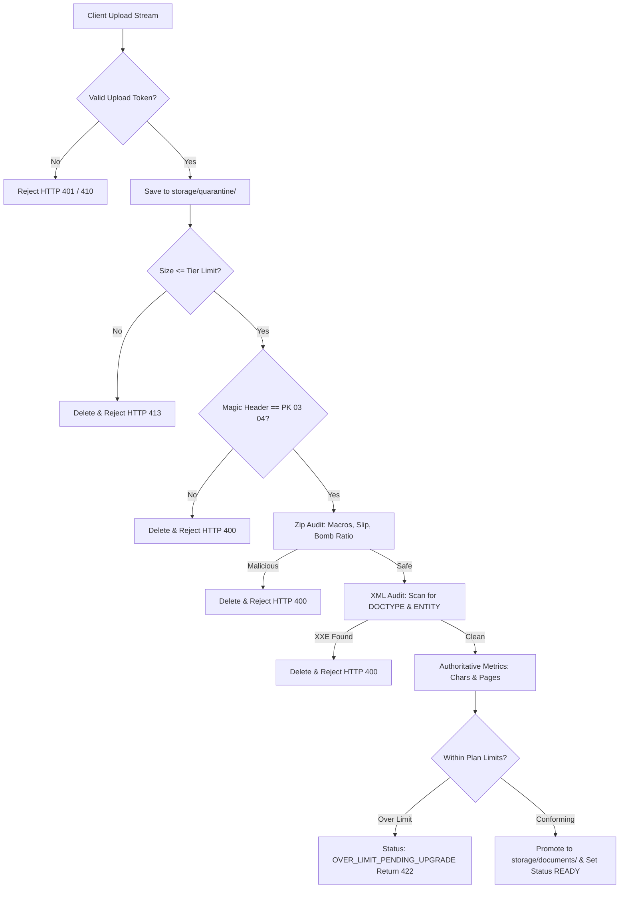

# Writelynx — Zero-Trust Upload Boundary & Quarantine Inspection

## 1. Zero-Trust Ingestion Architecture

User-submitted DOCX files are treated as untrusted binary blobs. Files land in an isolated quarantine directory (`storage/quarantine/`) and undergo multi-stage deep inspection before promotion to the main document repository.

---

## 2. Detailed Inspection Stages

### Stage 1: Size and Magic Bytes
- File size is checked against the plan tier maximum (`max_file_size_mb`). Basic: 10MB, Standard: 20MB, Extended: 30MB.
- Initial 4 bytes must match the ZIP standard header: `b"PK\x03\x04"`.

### Stage 2: Zip Member & Decompression Safety
- **Entry Count**: Maximum 5,000 members. Duplicate entry names trigger immediate rejection.
- **Package Integrity**: Requisite OpenXML members (`[Content_Types].xml`, `word/document.xml`, `_rels/.rels`) must be present.
- **Zip Slip Defense**: Path components are evaluated using `PurePosixPath`. Entries with absolute paths, `:`, or `..` are rejected.
- **Decompression Bomb Defense**: Total uncompressed payload cannot exceed 100MB. The decompression ratio cannot exceed 100:1.
- **Active Code Rejection**: Any entry matching `vbaProject.bin`, `vbaData.xml`, or ending with executable extensions (`.exe`, `.dll`, `.bat`, `.sh`, `.vbs`, `.bin`) triggers rejection.

### Stage 3: XXE & Entity Expansion Defense
All XML and `.rels` parts are scanned in memory for `<!DOCTYPE` and `<!ENTITY` declarations before DOM parsing. Any attempt to declare external entities is blocked.

### Stage 4: Authoritative Metric Extraction
- Total characters and words are extracted from all paragraphs and table cells.
- Page counts are conservatively estimated using explicit Word OpenXML breaks (`w:lastRenderedPageBreak`, `w:br[@w:type='page']`) and typographical density:
  $$\text{Page Count} = \max\Big(1,\; \text{Breaks} + 1,\; \lceil\text{Characters} / 3000\rceil,\; \lceil\text{Words} / 450\rceil\Big)$$
- If the document exceeds purchased plan limits, the system preserves the student's entitlement in `OVER_LIMIT_PENDING_UPGRADE` and returns HTTP 422 with the exact price difference required for an upgrade.
